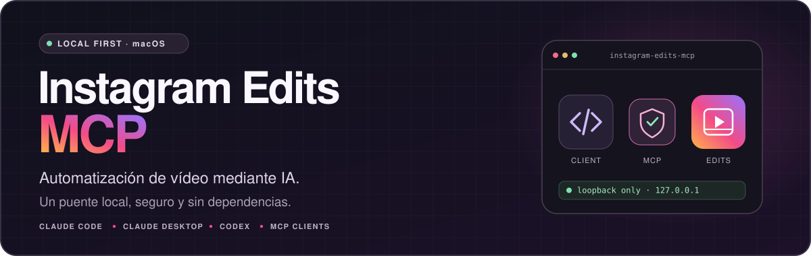
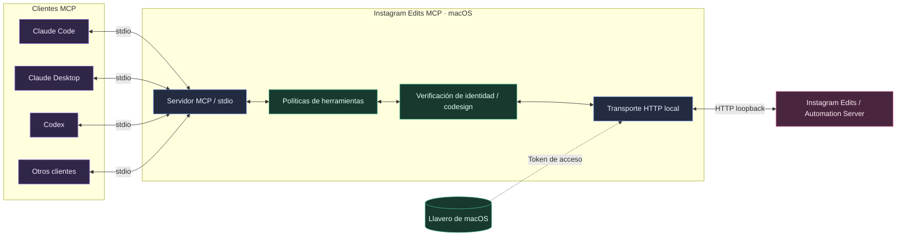

<div align="center">
  

  <br />

  [](https://edits.instagram.com/desktop)
  [](https://www.python.org/downloads/)
  [](https://modelcontextprotocol.io/)
  [](LICENSE)

  [](docs/THREAT_MODEL.md)
  [](#-desarrollo)
  [](https://github.com/mier48/instagram-edits-mcp/stargazers)

  **Conecta tu agente de IA con Instagram Edits para Mac.**

  Un servidor MCP local, con seguridad reforzada y descubrimiento dinámico de herramientas.

  [Inicio rápido](#-inicio-rápido) · [Arquitectura](#-arquitectura) · [Seguridad](#-seguridad) · [Documentación](#-documentación) · [Desarrollo](#-desarrollo)
</div>

---

## 🎬 ¿Qué es Instagram Edits MCP?

**Instagram Edits MCP** conecta Claude Code, Claude Desktop, Codex o cualquier cliente compatible con MCP por `stdio` al servidor de automatización integrado en [Instagram Edits para Mac](https://edits.instagram.com/desktop).

Permite que un agente de IA utilice las herramientas de automatización que Edits expone en cada pantalla, manteniendo el catálogo sincronizado a medida que cambia el estado de la aplicación.

> [!NOTE]
> El catálogo de herramientas depende del contexto de Edits. Las cifras siguientes son orientativas, no un límite fijo ni una garantía de disponibilidad.

<div align="center">

| 🏠 Pantalla de inicio | 🎞️ Proyecto abierto | 📦 Dependencias de ejecución |
| :---: | :---: | :---: |
| **~30 herramientas** | **~270 herramientas** | **0** |

</div>

## ✨ Características

| | Característica | Descripción |
| :---: | --- | --- |
| 🔒 | **Local first** | Exclusivamente conexiones HTTP a direcciones IP literales de loopback. Sin proxies, redirecciones ni telemetría. |
| 🛡️ | **Verificación de identidad** | Comprueba con `codesign` la identidad del proceso de Edits antes de transmitir el token. |
| 🔑 | **Llavero de macOS** | Almacena el token en Keychain, sin archivos de configuración en texto plano ni exposición en argumentos o logs. |
| 🚦 | **Control de permisos** | Modo de solo lectura y políticas `allow` / `deny` por herramienta. |
| ⚡ | **Descubrimiento dinámico** | Notifica al cliente los cambios en el catálogo de herramientas de Edits. |
| 🔄 | **Arranque independiente** | Puede iniciarse antes que Edits, con diagnóstico mediante `edits_connection_status`. |
| 🐍 | **Sin dependencias externas** | Utiliza exclusivamente la biblioteca estándar de Python 3.12 o posterior en ejecución. |
| 🧩 | **Integración con clientes MCP** | Plugin para Claude Code e integración por `stdio` con otros clientes. |

## 🏗️ Arquitectura



El servidor actúa como puente entre el protocolo MCP y la API local de automatización de Edits. Filtra las herramientas según la política configurada y verifica la identidad del servidor de destino antes de enviar el token.

Más información en [Architecture](docs/ARCHITECTURE.md).

## 🚀 Inicio rápido

### 1. Habilitar el servidor de Edits

En Instagram Edits para Mac, abre **Settings → Automation → Enable Automation Server** y copia el *Access token*.

### 2. Instalar Python

Necesitas Python 3.12 o posterior. Si utilizas Homebrew:

```bash
brew install python@3.12
```

### 3. Elegir un cliente MCP

| Cliente | Instalación |
| --- | --- |
| **Claude Code** | Plugin desde GitHub o configuración MCP por `stdio`. |
| **Claude Desktop** | Configuración MCP por `stdio`. |
| **Codex** | Configuración MCP por `stdio`. |
| **Otros clientes** | Cualquier cliente compatible con MCP por `stdio`. |

#### Claude Code — plugin

Desde Claude Code, ejecuta:

```text
/plugin marketplace add mier48/instagram-edits-mcp
/plugin install instagram-edits-mcp@instagram-edits-mcp
```

Consulta [la guía de instalación](docs/INSTALL.md) para configurar el token y completar la integración.

#### Claude Desktop, Codex u otros clientes

Clona el repositorio:

```bash
git clone https://github.com/mier48/instagram-edits-mcp.git
cd instagram-edits-mcp
```

Guarda el token de acceso en el llavero de macOS:

```bash
./bin/instagram-edits-mcp set-token
```

Verifica la configuración:

```bash
./bin/instagram-edits-mcp doctor
```

Registra en el cliente MCP el ejecutable mediante su ruta absoluta, con el argumento `serve` y transporte `stdio`:

```text
/RUTA/instagram-edits-mcp/bin/instagram-edits-mcp serve
```

> [!TIP]
> Consulta [docs/INSTALL.md](docs/INSTALL.md) para obtener la configuración específica de Claude Desktop, Claude Code y Codex.

## 🔐 Seguridad

La seguridad constituye una parte central del diseño del servidor, no una funcionalidad opcional.

- **Red restringida:** la URL debe utilizar `http://` y una IP literal de loopback. No se admiten proxies, redirecciones ni otras conexiones de red desde el servidor MCP.
- **Identidad del proceso:** antes de enviar el token, se verifica con `codesign` que el proceso que escucha en el puerto está firmado por Instagram, Inc., con los siguientes identificadores:

  | Parámetro | Valor esperado |
  | --- | --- |
  | Team ID | `777W53UFB2` |
  | Identificador | `com.burbn.basel.mac` |

- **Gestión de secretos:** el token reside en el llavero de macOS y no se escribe en archivos en texto plano ni se expone en argumentos de línea de órdenes, logs, errores o en la salida de `doctor`.
- **Políticas de herramientas:** el modo de solo lectura y las reglas `allow` / `deny` se aplican tanto al listado como a la ejecución de herramientas.

> [!IMPORTANT]
> La ejecución local y la verificación de identidad no eliminan todos los riesgos asociados a conceder acceso de automatización a un agente de IA. Consulta el [modelo de amenazas](docs/THREAT_MODEL.md) para conocer los controles y riesgos residuales. Utiliza una política restrictiva cuando no necesites acceso completo.

Para comunicar una vulnerabilidad, consulta [SECURITY.md](SECURITY.md).

## 🖥️ Órdenes CLI

| Orden | Descripción |
| --- | --- |
| `serve` | Inicia el servidor MCP por `stdio`. Orden por defecto. |
| `doctor [--json]` | Comprueba la app, la identidad del servidor, el token, la política y las herramientas. No muestra secretos. |
| `set-token` | Guarda el token en el llavero de macOS. |
| `delete-token` | Elimina el token del llavero. |
| `config` | Muestra la configuración efectiva. |

## 📚 Documentación

| Documento | Contenido |
| --- | --- |
| [Installation](docs/INSTALL.md) | Instalación y configuración de clientes. |
| [Configuration](docs/CONFIGURATION.md) | Fichero TOML, variables de entorno, políticas y verificación. |
| [Architecture](docs/ARCHITECTURE.md) | Módulos y flujo de una petición. |
| [Threat model](docs/THREAT_MODEL.md) | Activos, amenazas, controles y riesgos residuales. |
| [Security policy](SECURITY.md) | Procedimiento de comunicación de vulnerabilidades. |

## 🛠️ Desarrollo

El servidor no requiere dependencias externas en ejecución. `pytest` se utiliza exclusivamente para desarrollo y pruebas.

```bash
python3.12 -m venv .venv
source .venv/bin/activate
pip install pytest==9.1.1
python -m pytest
```

Las pruebas utilizan un doble de Edits en `127.0.0.1` y tokens ficticios. No requieren Edits, acceso a red externa ni acceso al llavero. En macOS, dos pruebas de seguridad utilizan además los ejecutables reales `lsof` y `codesign`.

## 📄 Licencia

Distribuido bajo la licencia [MIT](LICENSE).

Este es un proyecto independiente, sin relación con Meta, Instagram ni Anthropic, y sin su respaldo. «Instagram» y «Edits» son marcas de Meta Platforms, Inc.

---

<div align="center">

  **Local first. Security by design.**

  <sub>Instagram Edits MCP · <a href="https://github.com/mier48/instagram-edits-mcp">GitHub</a></sub>

</div>
